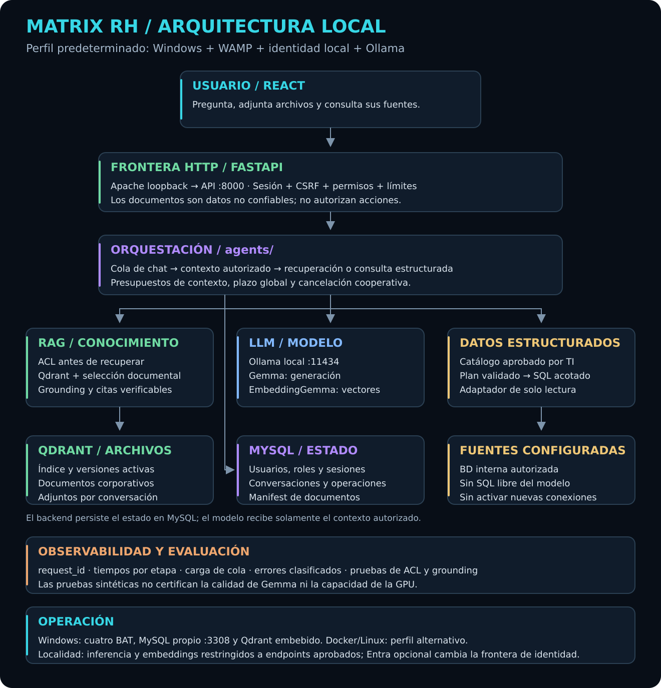
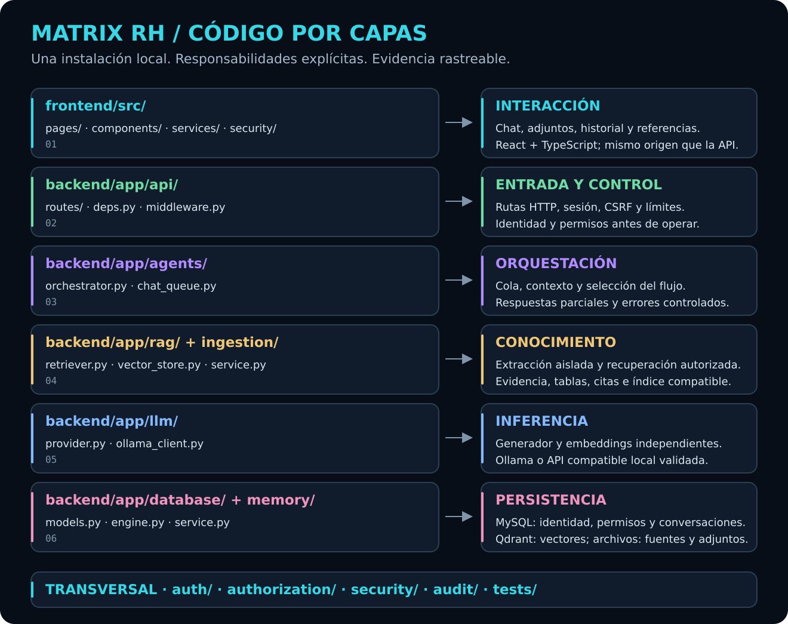

# Matrix RH

<!-- Creado por Aldo Garcia. -->

**Asistente de inteligencia artificial local para consultar conocimiento de Recursos Humanos con acceso por rol y respuestas respaldadas por documentos.**

Matrix RH integra una interfaz de chat, una API de negocio, recuperación documental y modelos de lenguaje locales. Permite consultar información autorizada, resumir secciones, comparar fuentes y trabajar con adjuntos privados dentro de una conversación. Las respuestas documentales incluyen referencias para localizar la evidencia utilizada.

## Capacidades

- **Consulta documental:** búsqueda de información dentro de las categorías y documentos autorizados para cada usuario.
- **Síntesis y comparación:** resúmenes de documentos o secciones y comparación de fuentes disponibles.
- **Conversaciones persistentes:** historial y contexto asociados al usuario y a la conversación.
- **Adjuntos privados:** análisis de archivos con alcance delimitado por propietario y conversación.
- **Trazabilidad:** presentación de fuentes, páginas y referencias vinculadas a las respuestas.
- **Control de operaciones:** estados de espera y procesamiento, gestión de capacidad y cancelación desde el chat.

## Arquitectura



La aplicación separa la interacción del usuario, la entrada HTTP, la orquestación, el procesamiento documental, la inferencia y la persistencia. La API aplica la autorización antes de construir el contexto que recibe el modelo.

### Componentes principales

| Componente | Tecnología | Responsabilidad |
|---|---|---|
| Interfaz | React y TypeScript | Conversaciones, mensajes, adjuntos, estados de operación y visualización de fuentes |
| API | Python y FastAPI | Sesiones, validación de solicitudes, autorización y contratos de la aplicación |
| Orquestación | Servicios y agentes Python | Selección del flujo, coordinación de tareas, capacidad, plazos y cancelación |
| Recuperación documental | RAG y Qdrant | Búsqueda semántica y selección de fragmentos autorizados |
| Inferencia y embeddings | Ollama y adaptadores de modelos locales | Generación de respuestas y representación vectorial del texto |
| Persistencia relacional | MySQL y SQLAlchemy | Usuarios, permisos, conversaciones, operaciones y metadatos |
| Archivos | Almacenamiento local | Documentos de conocimiento y adjuntos asociados a su ámbito de acceso |

### Organización por capas



| Capa | Ubicación | Responsabilidad |
|---|---|---|
| Presentación | `frontend/src/pages`, `components`, `services` | Interacción del usuario y comunicación con la API |
| Entrada HTTP | `backend/app/api` | Rutas, dependencias, validación y controles de solicitud |
| Orquestación | `backend/app/agents` | Coordinación de flujos y ejecución de operaciones |
| Ingesta y conocimiento | `backend/app/ingestion`, `backend/app/rag` | Extracción, fragmentación, indexación, recuperación y comprobación de evidencia |
| Integración de modelos | `backend/app/llm` | Contratos de generación y embeddings mediante adaptadores |
| Persistencia y memoria | `backend/app/database`, `backend/app/memory` | Acceso a datos y contexto de conversación |
| Identidad y controles comunes | `auth`, `authorization`, `security`, `audit` dentro de `backend/app` | Autenticación, permisos, protección de solicitudes y trazabilidad |

### Flujo de una respuesta

1. **Solicitud:** el usuario escribe una pregunta o adjunta un documento desde el chat.
2. **Validación:** la API comprueba la sesión, la solicitud y los permisos aplicables.
3. **Orquestación:** se reserva capacidad y se selecciona el flujo de consulta, resumen o análisis.
4. **Contexto:** el sistema reúne el historial pertinente y recupera evidencia dentro del alcance autorizado.
5. **Generación:** el modelo local recibe instrucciones, contexto y fragmentos seleccionados.
6. **Comprobación:** se verifican las afirmaciones documentales y sus referencias. Si la evidencia es insuficiente, la respuesta comunica esa limitación.
7. **Presentación y persistencia:** se guardan la operación y los mensajes, y el chat presenta la respuesta con sus fuentes.

## Conocimiento y contexto

Matrix utiliza **RAG —generación aumentada por recuperación—** para incorporar conocimiento documental a las respuestas. La ingesta extrae el contenido, lo divide en fragmentos y genera embeddings para su indexación en Qdrant. Los metadatos mantienen la relación entre cada fragmento, su documento, su localización y su ámbito de acceso.

La recuperación filtra por permisos, propietario y conversación según el tipo de fuente. Los índices utilizan generaciones activas y representaciones compatibles con el modelo de embeddings configurado. Los resúmenes recorren el documento o la sección seleccionada con un presupuesto de contexto acotado.

La memoria de conversación aporta continuidad a las consultas de seguimiento. La caché de embeddings reutiliza representaciones de consultas; el contexto enviado al modelo se construye para cada operación con las fuentes y permisos correspondientes.

## Identidad y privacidad

La autorización se aplica en el backend y delimita los documentos, categorías, conversaciones y adjuntos accesibles. La interfaz presenta las operaciones disponibles para el usuario, mientras que la API verifica sus permisos en cada solicitud.

El perfil `standalone` mantiene autenticación, inferencia, embeddings y persistencia en el entorno local. La integración opcional con Microsoft Entra ID utiliza un proveedor externo de identidad y corresponde a un perfil híbrido de autenticación. La preparación de dependencias requiere acceso a sus proveedores de distribución.

Los documentos empresariales y los datos de las conversaciones pertenecen a la instalación. El repositorio distribuye el código y utiliza datos sintéticos para sus pruebas.

## Entornos de ejecución

| Entorno | Composición |
|---|---|
| Windows con WampServer | Apache como entrada web, API Python, interfaz compilada, MySQL propio, Qdrant embebido y Ollama local |
| Linux con Docker | Servicios separados para la aplicación, MySQL, Qdrant, Ollama y proxy Nginx |

Los adaptadores de modelos separan la integración con el runtime de la lógica de negocio. La generación y los embeddings se configuran de forma independiente; el modelo de embeddings determina la compatibilidad de la representación vectorial del índice.

## Estructura del repositorio

| Directorio | Contenido |
|---|---|
| `backend/` | API, servicios, agentes, ingesta, RAG, persistencia, configuración, migraciones y pruebas |
| `frontend/` | Interfaz de chat, componentes, integración con la API y pruebas de interacción |
| `knowledge-base/` | Área reservada para conocimiento local autorizado, excluido de la distribución de código |

## Instalación y operación

### Windows local

El controlador actual requiere **Windows x64, PowerShell x64 5.1 o posterior y WampServer**. El proyecto debe estar dentro del `www` del WampServer elegido, por ejemplo `C:\wamp64\www\Matrix_v4` o `D:\wamp64\www\Matrix_v4`. Una carpeta independiente `C:\www` no satisface ese requisito. WAMP aporta Apache; Matrix administra su propio MySQL.

1. Conserve una copia completa y coherente de cualquier instalación anterior. Para una instalación nueva, extraiga el código en una carpeta vacía; no superponga archivos sobre datos existentes.
2. Mantenga activo su Ollama local y compruebe con `ollama list` las etiquetas de generación y embeddings de [env.example](backend/config/env.example). El instalador no descarga ni sustituye esos modelos.
3. Ejecute `instalar.bat` como administrador para preparar runtimes, dependencias fijadas, cuenta local, esquema, índice e integración Apache. La preparación requiere red hacia distribuidores y servicios de avisos de seguridad. Los pins están en [runtime-manifest.json](backend/config/runtime-manifest.json).
4. El usuario inicial es `Matrix`; consulte la contraseña **solo localmente** en `backend/config/secrets/local-admin-password.txt` y cámbiela al entrar. La configuración privada queda en `backend/config/.env`.
5. Después utilice `iniciar.bat`, `detener.bat` y `diagnosticar.bat`. El acceso local predeterminado es `http://127.0.0.1:8085`. Detener Matrix conserva Apache y el Ollama externo.

Los directorios `backend/config`, `backend/runtime` y `knowledge-base` pertenecen a la instalación. No se deben borrar para actualizar código. `frontend/dist` se distribuye y se reconstruye con el Node/npm fijado; no es basura. Antes de actualizar, detenga Matrix y use `scripts.installation_backup` desde el Python de esa instalación para preparar y verificar un respaldo en frío. Ese comando no acredita una recuperación MySQL: ensáyela en una copia separada antes de reemplazar la instalación.

### Gestión de cuentas locales

Con `AUTH_PROVIDER=local`, un administrador con `users.admin` puede usar `PATCH /api/v1/admin/users/{id}` para cambiar `is_active` (booleano) o `role` (`matrix_admin` o `prestaciones_reader`). Requiere sesión vigente y token CSRF. Los cambios efectivos revocan las sesiones del usuario; reactivarlo no recupera sesiones antiguas ni cambia su contraseña. Se impide desactivar o degradar al último administrador local activo. Las identidades federadas se administran en su proveedor.

El operador de la instalación dispone de los mismos cambios desde `backend`, con el Python de Matrix y su configuración local:

```bash
python -m scripts.local_identity set-active --username CUENTA --inactive
python -m scripts.local_identity set-active --username CUENTA --active
python -m scripts.local_identity set-role --username CUENTA --role prestaciones_reader
```

Son acciones administrativas explícitas: revise la cuenta antes de ejecutarlas. No borran conversaciones ni documentos. Los intentos de contraseña fallidos reciben un 401 genérico y una demora progresiva de respuesta, hasta dos segundos; no bloquean persistentemente la cuenta del titular. Se conservan los límites HTTP por IP. La protección es por proceso y no acredita resistencia a un ataque distribuido.

### Desarrollo y comprobaciones aisladas

Utilice una copia sin `.env`, documentos ni datos productivos, Python 3.12 y Node compatible con `frontend/package.json`. Desde la raíz:

```bash
uv sync --project backend --locked --extra dev --no-install-project --no-build
cd frontend
corepack npm ci --ignore-scripts --no-audit --no-fund
corepack npm run typecheck
corepack npm run lint
corepack npm test
corepack npm run build
```

Desde `backend`, en Linux/macOS:

```bash
APP_ENV=test .venv/bin/python -m pytest tests -q -p scripts.quality_gate_pytest --matrix-test-group standalone --matrix-collection-report /tmp/matrix-collection.json
.venv/bin/python -m ruff check app scripts seeds tests
.venv/bin/python -m scripts.verify_documentation
.venv/bin/python -m scripts.secrets_scan
```

En PowerShell use `$env:APP_ENV='test'` y `.venv\Scripts\python.exe`. El grupo `standalone` recopila toda la suite y selecciona únicamente casos aislados, incluidas las consultas sobre SQLite temporal. Las pruebas que requieren MySQL/Ollama, la evaluación de respuestas reales y la instalación Windows se validan por separado. El gate completo (`python -m scripts.run_quality_gate`) exige un entorno desechable y conserva el estado `INCOMPLETE` si falta evidencia; no es un comando de diagnóstico para producción. Los errores de tipado de mypy bloquean el gate local igual que CI; una herramienta ausente no permite aprobarlo.

La CI también ejecuta una suite dirigida de recuperación vectorial con MySQL 8.4 y Qdrant 1.20.0 como servicios efímeros fijados por digest; repite los mismos escenarios con Qdrant embedded. Añade comprobaciones MySQL de cambios de cuentas y checkpoints del planificador. Aplica las migraciones reales en una base de pruebas, utiliza embeddings deterministas y rechaza pruebas omitidas o una ejecución parcial. Esta comprobación acredita los escenarios de transacciones seleccionados, no toda la integración ni los modelos de una instalación. El job de interfaz ejecuta Chromium sobre el build con respuestas API sintéticas; el E2E contra backend real sigue siendo una comprobación separada.

La automatización de GitHub ejecuta lint, contratos, pruebas aisladas, build y auditoría de dependencias en cada pull request. Las acciones están fijadas por commit y el token tiene permiso de lectura. Los casos omitidos bloquean esa comprobación: el runner necesita PowerShell para las pruebas sintéticas del controlador. Una prueba aislada aprobada no certifica capacidad ni calidad documental con el hardware y corpus de una instalación.

La matriz Windows ejecuta nueve fixtures del controlador en PowerShell 5.1 y 7, con servicios simulados. El build se compara byte a byte con `frontend/dist` del commit, incluidos archivos sobrantes. También se comprueba la coherencia de versiones entre paquetes, locks, manifiestos y Dockerfile. Las comprobaciones semanales y Dependabot se activan cuando la configuración llegue a la rama predeterminada; sus propuestas no se fusionan automáticamente.

El inventario CycloneDX se genera sin red desde ambos locks y se conserva como artefacto de CI durante 30 días. Para generarlo localmente, ejecute desde `backend`: `python -m scripts.generate_sbom --output var/reports/sbom.cdx.json`. Incluye dependencias de desarrollo, opcionales y de otras plataformas; no representa lo instalado, no incluye SO ni modelos y no certifica licencias o firmas.

La [auditoría del 27 de octubre de 2026](backend/release/audit-2026-10-27/report.md) registra las correcciones, el alcance de lectura, las pruebas y los riesgos pendientes. Su estado es provisional hasta validar la instalación real.

### Diagnóstico y medición opcionales

Swagger y OpenAPI solo se publican en `development` y `test`. El diagnóstico de `standalone` consulta BitLocker en Windows y avisa si no puede verificarlo; no activa cifrado. El respaldo en frío admite `python -m scripts.installation_backup backup --require-encrypted-destination`, que rechaza la copia si el volumen de destino no tiene BitLocker completo y activo. Esta opción protege el destino comprobado al crear el respaldo: los archivos no tienen cifrado propio y moverlos a otro volumen puede dejarlos expuestos.

`/ready` (también `/api/v1/ready`) devuelve solo `ready`, con HTTP 200 o 503. Los componentes internos se consultan en `/ready/details` con una sesión que tenga `diagnostics.read`; no se incluyen en la respuesta pública. El launcher soportado desactiva la cabecera `Server` de Uvicorn. `/health` conserva su información de aplicación/versión y los proxies pueden identificarse por separado.

La recepción de adjuntos tolera hasta 250 ms de espera por cupo, con cantidad de esperadores limitada. Una saturación real puede devolver `503 upload_capacity_full`, `Retry-After` y un `request_id` para diagnóstico. Un archivo de texto binario o que exceda un presupuesto indivisible devuelve 422; los límites de extracción no se relajan.

Desde `backend`, `python -m scripts.model_warmup` muestra un plan sin red. Añadir `--run --target both --profile fast --timeout-seconds 60` ejecuta sondas sintéticas con los modelos locales y digests configurados. Úselo sin tráfico de la aplicación: consume RAM/VRAM, puede expulsar otro modelo y no garantiza residencia simultánea. No descarga pesos ni cambia el arranque. `scripts.benchmark_response --generate` incorpora la comparación de tokens estimados con `prompt_eval_count` cuando existe un solo intento; la razón no demuestra truncamiento ni sustituye una evaluación documental.

`scripts.diagnosticar_rag` mantiene su diagnóstico de metadatos por defecto. La exportación de fragmentos requiere `--export-chunks var/revision.json --username CUENTA --document-id ID` y `--root` con la raíz de la instalación; para adjuntos también requiere `--conversation-id ID`. El archivo debe ser nuevo y privado. La cuenta necesita `diagnostics.read` y acceso vigente al documento; un administrador no obtiene acceso a conversaciones ajenas. La herramienta aplica límites de contenido, comprueba la generación activa y vuelve a validar permisos antes de guardar. Revise `complete` y `truncated` antes de evaluar cobertura. Para embedded, detenga Matrix; la revisión utiliza una copia temporal privada y acotada, y rechaza índices que excedan sus límites.

La [validación de mejoras del 15 de noviembre de 2026](backend/release/review-2026-11-15/report.md) contrasta cada propuesta del archivo recibido con el código actual, identifica lo aplicado y documenta lo que requiere mediciones reales.

El [contraste de la auditoría E2E](backend/release/e2e-2026-11-15/report.md) documenta las correcciones de vigencia documental, cuentas, cargas y readiness, con su evidencia y límites.

### Límites y actualización segura

- Los modelos y sus revisiones deben corresponder a los digests privados de la instalación. Cambiar embeddings requiere reconstruir y validar el índice.
- Los índices anteriores a esta auditoría no acreditan cobertura completa de extracción. Ejecute una reconciliación completa para incorporar los nuevos metadatos; el comando de altas `new_only` conserva ese alcance. El planificador usa una sincronización distinta que detecta altas, cambios SHA-256 y bajas, con archivos estables y lotes acotados. La vigencia no es instantánea: depende del intervalo, la carga, la disponibilidad de servicios y los errores de ingesta. Las omisiones conocidas conservan una advertencia de respuesta parcial.
- El mantenimiento y la reconciliación completa consultan checkpoints independientes en SQL; un reinicio no reinicia su vencimiento (24 horas por defecto). Las tareas vencidas se intentan al arrancar y se reintentan de forma acotada si fallan. Una fuente no accesible o un inventario incompleto no se interpreta como eliminación de todos sus documentos. Si una revisión falla al indexarse, se conserva la generación confirmada y se registra el fallo para reintento; revise el diagnóstico antes de dar por vigente esa revisión. El hashing periódico recorre el corpus y su coste debe medirse en la instalación real.
- La ingesta registra una intención persistente antes de escribir los vectores. El mantenimiento global recupera las candidatas pendientes después de un rollback o una interrupción de la ingesta y conserva la generación confirmada en SQL. Requiere que Qdrant y SQL vuelvan a estar disponibles y que se ejecute el reconciliador.
- Respalde y restaure el almacenamiento Qdrant completo, incluida la colección `<colección corporativa>__generation_intents`. Restaurar únicamente las colecciones de contenido pierde las intenciones pendientes. Los respaldos nativo y preparado del proyecto conservan el árbol completo.
- Para exposición a red se requieren HTTPS, cookies seguras y un proveedor de identidad configurado. No convierta el perfil local en publicación LAN cambiando únicamente `APP_HOST`.
- Las políticas de categorías rechazan campos desconocidos, nombres repetidos y claves YAML duplicadas: corrija la configuración si el arranque la rechaza.
- El perfil Docker usa otra copia Linux y estado separado; no comparte un datadir activo con la instalación Windows. Su build y arranque necesitan validación específica en el entorno destino.

Los seis PDF retirados del árbol también se eliminaron del historial de las cuatro ramas. Consulte la [evidencia y los pasos pendientes de caché/PR en GitHub](backend/release/audit-2026-10-27/history-cleanup.md). Un clon anterior debe actualizarse sin fusionar la historia retirada.

### Revisar vectores anteriores a la recuperación automática

Las candidatas generadas antes de incorporar el registro de intenciones requieren una revisión explícita. Desde `backend`, use el Python del entorno de Matrix y compruebe primero que la configuración apunta a su SQL e índice correctos. Para Qdrant embedded, detenga Matrix antes de abrir su almacenamiento.

```bash
python -m scripts.cleanup_vector_generations --scope corporate
python -m scripts.cleanup_vector_generations --scope conversation
```

Estos comandos sólo diagnostican: consultan identificadores y generaciones, sin recuperar texto ni embeddings. Cada lote revisa como máximo 128 puntos y devuelve `manifest_count`, generaciones candidatas y `next_offset`. Revise el resultado; para aplicar repita el mismo ámbito y offset añadiendo `--apply --expected-manifest-count N`, sustituyendo `N` por el conteo SQL observado. Después continúe con `--offset` y el `next_offset` devuelto hasta que sea nulo. El número de generaciones no equivale al número de puntos borrados.

Una base SQL vacía bloquea el borrado salvo que el operador añada `--allow-empty-manifest` después de verificar que ese vacío es intencional. Un error SQL o bloqueo impide borrar el candidato afectado; los lotes parciales se pueden reintentar. Las generaciones activas se preservan y los metadatos inválidos requieren revisión, sin borrado automático. Esta herramienta no se ejecuta por el scheduler.

Creado por Aldo Garcia.
