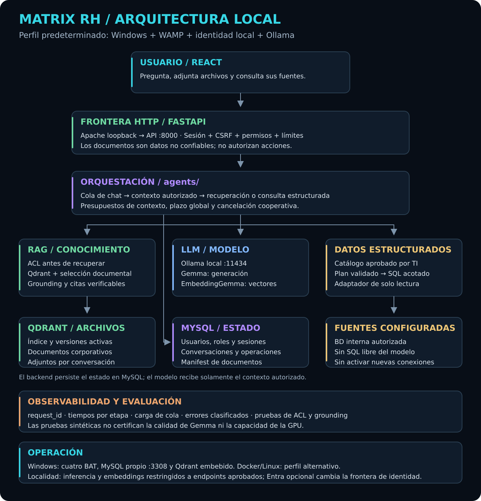
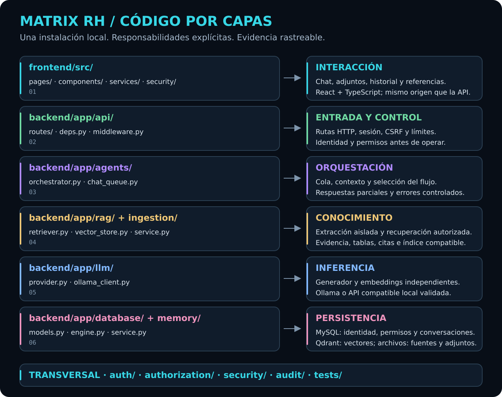

# Matrix RH

<!-- Creado por Aldo Garcia. -->

**Asistente de inteligencia artificial local para consultar conocimiento de Recursos Humanos con acceso por rol y respuestas respaldadas por documentos.**

Matrix RH integra una interfaz de chat, una API de negocio, recuperación documental y modelos de lenguaje locales. Permite consultar información autorizada, resumir secciones, comparar fuentes y trabajar con adjuntos privados dentro de una conversación. Las respuestas documentales incluyen referencias para localizar la evidencia utilizada.

## Capacidades

- **Consulta documental:** búsqueda de información dentro de las categorías y documentos autorizados para cada usuario.
- **Síntesis y comparación:** resúmenes de documentos o secciones y comparación de fuentes disponibles.
- **Conversaciones persistentes:** historial y contexto asociados al usuario y a la conversación.
- **Adjuntos privados:** análisis de archivos con alcance delimitado por propietario y conversación.
- **Trazabilidad:** presentación de fuentes, páginas y referencias vinculadas a las respuestas.
- **Control de operaciones:** estados de espera y procesamiento, gestión de capacidad y cancelación desde el chat.

## Arquitectura

La aplicación separa la interacción del usuario, la entrada HTTP, la orquestación, el procesamiento documental, la inferencia y la persistencia. La API aplica la autorización antes de construir el contexto que recibe el modelo.

### Componentes principales

| Componente | Tecnología | Responsabilidad |
|---|---|---|
| Interfaz | React y TypeScript | Conversaciones, mensajes, adjuntos, estados de operación y visualización de fuentes |
| API | Python y FastAPI | Sesiones, validación de solicitudes, autorización y contratos de la aplicación |
| Orquestación | Servicios y agentes Python | Selección del flujo, coordinación de tareas, capacidad, plazos y cancelación |
| Recuperación documental | RAG y Qdrant | Búsqueda semántica y selección de fragmentos autorizados |
| Inferencia y embeddings | Ollama y adaptadores de modelos locales | Generación de respuestas y representación vectorial del texto |
| Persistencia relacional | MySQL y SQLAlchemy | Usuarios, permisos, conversaciones, operaciones y metadatos |
| Archivos | Almacenamiento local | Documentos de conocimiento y adjuntos asociados a su ámbito de acceso |

### Organización por capas

| Capa | Ubicación | Responsabilidad |
|---|---|---|
| Presentación | `frontend/src/pages`, `components`, `services` | Interacción del usuario y comunicación con la API |
| Entrada HTTP | `backend/app/api` | Rutas, dependencias, validación y controles de solicitud |
| Orquestación | `backend/app/agents` | Coordinación de flujos y ejecución de operaciones |
| Ingesta y conocimiento | `backend/app/ingestion`, `backend/app/rag` | Extracción, fragmentación, indexación, recuperación y comprobación de evidencia |
| Integración de modelos | `backend/app/llm` | Contratos de generación y embeddings mediante adaptadores |
| Persistencia y memoria | `backend/app/database`, `backend/app/memory` | Acceso a datos y contexto de conversación |
| Identidad y controles comunes | `auth`, `authorization`, `security`, `audit` dentro de `backend/app` | Autenticación, permisos, protección de solicitudes y trazabilidad |

### Flujo de una respuesta

1. **Solicitud:** el usuario escribe una pregunta o adjunta un documento desde el chat.
2. **Validación:** la API comprueba la sesión, la solicitud y los permisos aplicables.
3. **Orquestación:** se reserva capacidad y se selecciona el flujo de consulta, resumen o análisis.
4. **Contexto:** el sistema reúne el historial pertinente y recupera evidencia dentro del alcance autorizado.
5. **Generación:** el modelo local recibe instrucciones, contexto y fragmentos seleccionados.
6. **Comprobación:** se verifican las afirmaciones documentales y sus referencias. Si la evidencia es insuficiente, la respuesta comunica esa limitación.
7. **Presentación y persistencia:** se guardan la operación y los mensajes, y el chat presenta la respuesta con sus fuentes.

## Conocimiento y contexto

Matrix utiliza **RAG —generación aumentada por recuperación—** para incorporar conocimiento documental a las respuestas. La ingesta extrae el contenido, lo divide en fragmentos y genera embeddings para su indexación en Qdrant. Los metadatos mantienen la relación entre cada fragmento, su documento, su localización y su ámbito de acceso.

La recuperación filtra por permisos, propietario y conversación según el tipo de fuente. Los índices utilizan generaciones activas y representaciones compatibles con el modelo de embeddings configurado. Los resúmenes recorren el documento o la sección seleccionada con un presupuesto de contexto acotado.

La memoria de conversación aporta continuidad a las consultas de seguimiento. La caché de embeddings reutiliza representaciones de consultas; el contexto enviado al modelo se construye para cada operación con las fuentes y permisos correspondientes.

## Identidad y privacidad

La autorización se aplica en el backend y delimita los documentos, categorías, conversaciones y adjuntos accesibles. La interfaz presenta las operaciones disponibles para el usuario, mientras que la API verifica sus permisos en cada solicitud.

El perfil `standalone` mantiene autenticación, inferencia, embeddings y persistencia en el entorno local. La integración opcional con Microsoft Entra ID utiliza un proveedor externo de identidad y corresponde a un perfil híbrido de autenticación. La preparación de dependencias requiere acceso a sus proveedores de distribución.

Los documentos empresariales y los datos de las conversaciones pertenecen a la instalación. El repositorio distribuye el código y utiliza datos sintéticos para sus pruebas.

## Entornos de ejecución

| Entorno | Composición |
|---|---|
| Windows con WampServer | Apache como entrada web, API Python, interfaz compilada, MySQL propio, Qdrant embebido y Ollama local |
| Linux con Docker | Servicios separados para la aplicación, MySQL, Qdrant, Ollama y proxy Nginx |

Los adaptadores de modelos separan la integración con el runtime de la lógica de negocio. La generación y los embeddings se configuran de forma independiente; el modelo de embeddings determina la compatibilidad de la representación vectorial del índice.

## Estructura del repositorio

| Directorio | Contenido |
|---|---|
| `backend/` | API, servicios, agentes, ingesta, RAG, persistencia, configuración, migraciones y pruebas |
| `frontend/` | Interfaz de chat, componentes, integración con la API y pruebas de interacción |
| `knowledge-base/` | Área reservada para conocimiento local autorizado, excluido de la distribución de código |

Creado por Aldo Garcia.
